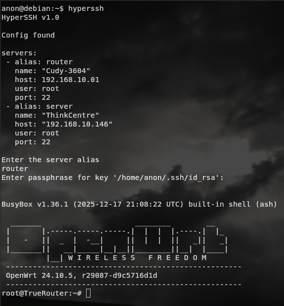

# HyperSSH
A simple program written in the Ruby programming language.
The program allows for quick SSH connections. 
You configure the settings once and then connect to servers rapidly using aliases.
Connect to your servers in seconds.


## Configuration example
(`~/.ssh/servers.yaml`)
~~~
servers: 
 - alias: router
   name: "Samsung"
   host: 192.168.10.01
   user: root
   port: 22
 - alias: server
   name: "HP"
   host: "192.168.10.146"
   user: root
   port: 22
~~~

The configuration path defaults to `~/.ssh/servers.yaml`. Override it by setting
the `SSH_CONFIG` environment variable when running HyperSSH:
~~~
SSH_CONFIG=/path/to/servers.yaml hyperssh
~~~

## installation
1. clone the repository
```sh
git clone https://github.com/Efesint/HyperSSH && cd HyperSSH
```
2.Make sure you have Ruby on your pc
```sh
sudo apt install ruby
```
3. Make hyperssh executable
```sh
chmod +x hyperssh
```
4. Move the file to (`/usr/local/bin/`).
```sh 
sudo mv HyperSSH.rb /usr/local/bin/hyperssh
```
# Mirror on codeberg and gitlab
https://codeberg.org/efesint/hyperssh
<br>https://gitlab.com/Efesint0/HyperSSH

# LICENSE 
This product is released under the GNU General Public License v3.0
